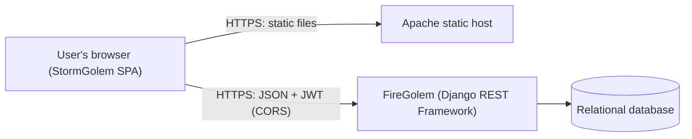
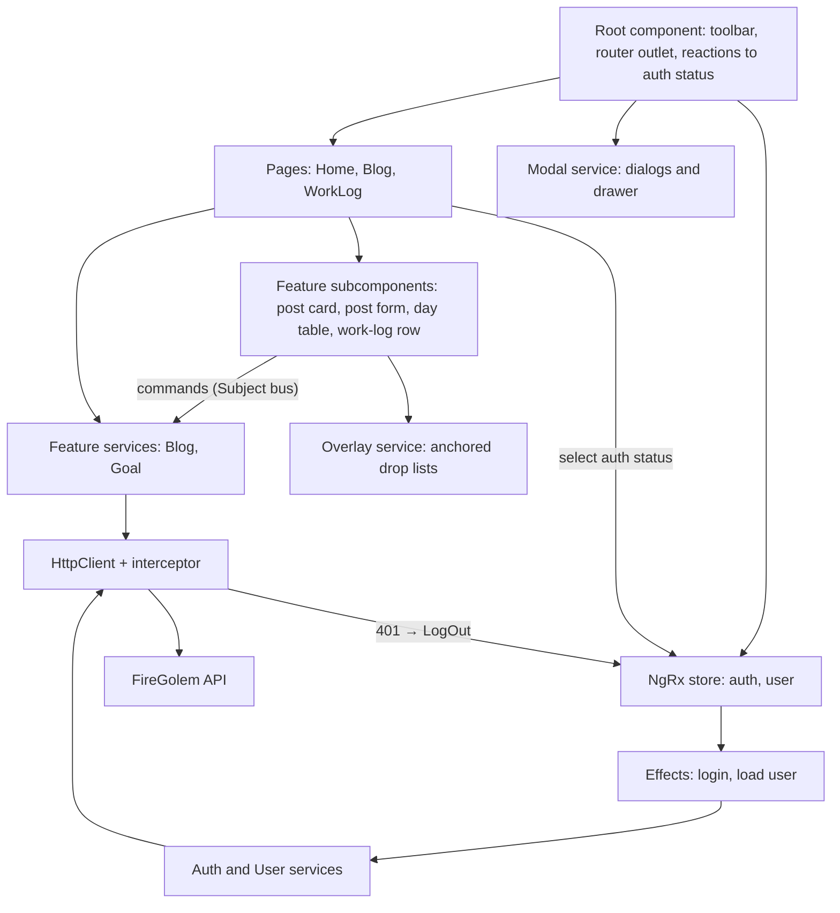
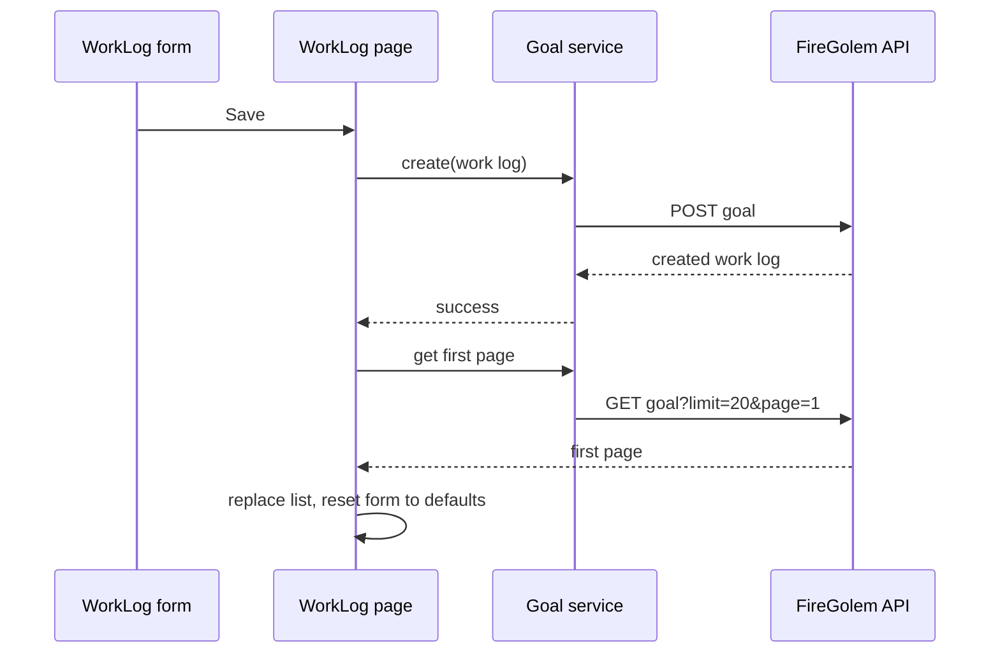
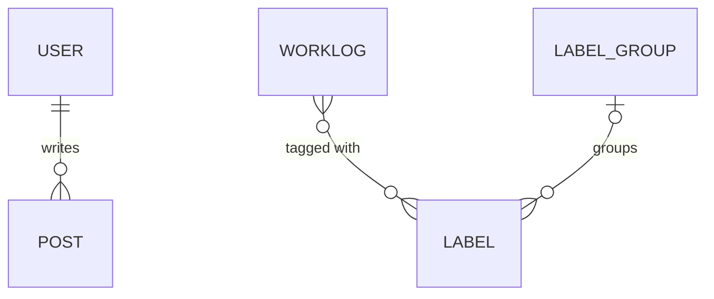
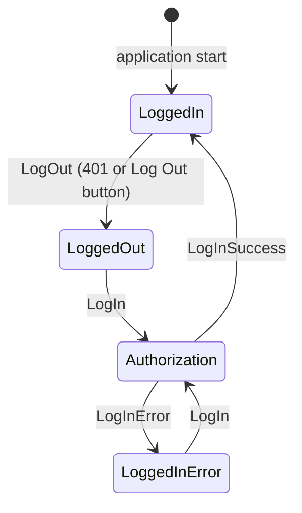
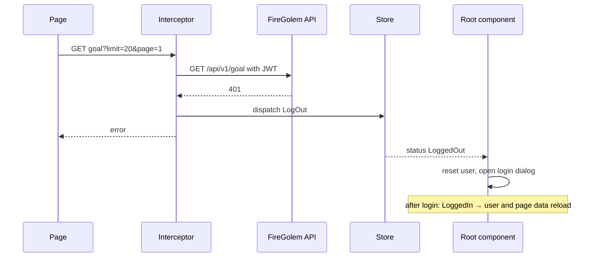
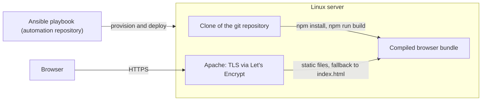

# StormGolem — Design Document

StormGolem is the web client of the **FireGolem** backend. It is a single-page application with a personal blog and a
work log. This document describes the client's purpose, architecture, navigation, state management, interaction
design, session handling, visual design system and runtime environment. It focuses on stable design decisions rather
than implementation details that change frequently.

---

## 1. Purpose and Scope

StormGolem gives a small, trusted group of users a browser UI for data kept by FireGolem. It has three pages, all
reachable from the main menu:

| Page | Purpose |
|---|---|
| **Home** | Landing page. It loads no data and is used as a static sandbox for layout prototypes. |
| **Blog** | Write and read text posts, edit and delete them. |
| **WorkLog** | Record time spent on work: a duration, a day, a short note and labels. Review entries grouped by day, edit and delete them. |

Design boundaries:

- The server is the single source of truth and owns all rules: ordering, paging, post authorship and timestamps,
  label resolution and soft deletion of posts. The client displays what the server returns.
- User accounts are provisioned on the server. The client only logs in, logs out and shows the current user's name.
- Labels are reference data managed on the server. The client only picks existing labels; it does not create, rename
  or group them.
- The UI targets desktop browsers: content is a fixed-width, centered column.

**Naming.** In code and in the API, the work-log area is called **goal**: the `goal` API resource returns work logs,
and the page component and its service are named after goals. In the UI and in the route, the same feature is called
**WorkLog**. Both names refer to the same feature.

StormGolem and FireGolem form one system. They are independent of the StoneGolem / EarthGolem TimeTracker system.

---

## 2. System Context



| Component | Responsibility |
|---|---|
| **StormGolem** | All UI, client-side routing, forms, token storage and the reaction to an expired session. |
| **Static web host** | Serves the compiled bundle, falls back to the SPA entry page for client-side routes, terminates TLS. |
| **FireGolem** | Issues and validates JWTs, persists data, orders and pages lists, enforces business rules. |

The client and the API live on separate origins: the client at `stormgolem.perforator.xyz` and the API at
`firegolem.perforator.xyz`. The browser calls the API directly, so FireGolem's CORS whitelist must contain the client
origin (and the local dev-server origin in development). There is no backend-for-frontend.

FireGolem exposes two kinds of endpoints that the client uses:

- the **token endpoint** at the root of the FireGolem host;
- the **versioned REST API** under the `api/v1/` prefix.

---

## 3. Technology Choices

| Concern | Choice | Rationale |
|---|---|---|
| Framework | Angular with NgModules. All application components are declared in one root module; routes are eager. | Complete SPA framework with DI, router, forms, HTTP client and animations. |
| Language | TypeScript with non-strict compiler settings | Typed models and services with low ceremony. |
| Reactivity | RxJS observables | Natural fit for HTTP calls, store selections and component-to-component commands. |
| Session state | NgRx Store and Effects, used **only** for authentication status and the current user | An explicit authentication state machine with side effects kept out of components. |
| Forms | Reactive forms (untyped) plus a custom `ControlValueAccessor` for label selection | Simple form handling and a label picker that plugs into a form like a native control. |
| Dialogs and drawer | A custom modal service that renders dynamically created components into the document body | Full control over placement, animation and closing behavior. |
| Anchored popups | Angular CDK Overlay and Portal behind a small overlay service | Positioning relative to an anchor element and outside-click handling. |
| Scrolling | Angular CDK scrolling viewport as the page scroll container | Scroll notifications that drive infinite loading. |
| Motion | Angular animations | Enter animations for dialogs, the drawer and drop-down lists. |
| Utilities | lodash for set operations; ng-click-outside for closing dialogs | Small, focused helpers. |
| Styling | SCSS with a hand-written Sass color palette; no component library | A consistent, lightweight look. |
| Build | Angular CLI browser builder | Standard bundling, output hashing and environment file replacement. |
| Style linting | stylelint with the standard configuration | Consistent stylesheet formatting. |

---

## 4. Architecture

### 4.1 Building Blocks



- **Root component (shell).** Renders the fixed toolbar and the router outlet. It reacts to the authentication status:
  it loads the current user after login and opens the login dialog after logout (see §8.3).
- **Pages.** One routed component per page. A page owns the data it shows: the loaded list, the page counter, the
  selected item and the page's form.
- **Feature subcomponents.** Building blocks of a page, such as the post card and post form of the blog, or the day
  table and work-log row of the WorkLog. They do not change data themselves; they publish commands that the page
  executes (see §4.3).
- **Resource services.** Application-wide singletons, one per API resource family: Auth, User, Blog and Goal. They
  are thin wrappers around HTTP calls and return observables. The Blog and Goal services also host their feature's
  command bus.
- **Store.** Holds the session-wide state only (see §4.2). Effects perform the login request and the loading of the
  current user.
- **HTTP interceptor.** Applies the backend URL and the token to every request and turns a `401` into a logout
  (see §8.4).
- **Overlay infrastructure.** Two mechanisms with different roles: the **modal service** for dialogs and the side
  drawer, and the **overlay service** for small popups anchored to an element (see §7.6).
- **Shared components.** Presentational building blocks with no knowledge of the API: a button, image and SVG icons,
  the label tag input, the drop list and the not-found page.

### 4.2 Session State in the Store

The NgRx store holds only state that the whole application shares:

| Slice | Content |
|---|---|
| `auth` | The authentication status: `LoggedOut`, `Authorization` (login in progress), `LoggedIn` or `LoggedInError`. |
| `user` | The current user's profile and a loading flag. |

Domain data (posts, work logs, labels) is **not** kept in the store. Each page loads and holds its own data.

Store conventions:

- Actions are classes with a typed `type` taken from a per-feature enum of `[Feature] Event` strings.
- Reducers are pure `switch` statements over the action type.
- Effects perform HTTP calls and map results to success or error actions.
- Components read slices through feature selectors and react to the status with two small RxJS helpers: one that
  extracts the status and one that runs a callback per status (log in, log out, login error).
- A logging meta-reducer prints every action with the previous and the next state to the browser console.

### 4.3 Feature Command Bus

Inside a feature, nested components never call the API for changes. They publish a **command** on a `Subject` exposed
by the feature's service, and the page component executes it:

| Feature | Command | Published by | Handled by the page |
|---|---|---|---|
| Blog | create post (payload) | post form | Calls the API, then reloads the first page. |
| Blog | update post (payload) | post form | Calls the API, then reloads the first page. |
| Blog | delete post (payload) | post form | Calls the API, then reloads the first page. |
| WorkLog | edit work log (entry with its day) | row menu | Scrolls to the top, fills the form and switches it to edit mode. |
| WorkLog | delete work log (id) | row menu | Calls the API, then reloads the first page. |

The page is therefore the only place that owns the list, the paging state and the reload logic. Nested components
stay unaware of paging.

### 4.4 Data Loading and Refresh Model

The client has **no cache**. The server is the single source of truth, and every change is followed by a reload.

- **Initial load.** Data pages subscribe to the `auth` slice and load their first page whenever the status is
  `LoggedIn`. Because the initial status is `LoggedIn` (see §8.2), a page loads immediately when it is activated, and
  it loads again after a successful re-login.
- **Infinite scroll.** When the user scrolls to within 200 px of the bottom of the page's scroll container, the page
  requests the next page number. Requests for the same page number are deduplicated. Each received page is appended
  to the list. A failed page request ends loading silently; FireGolem answers a request beyond the last page with an
  error.
- **After a change.** After every successful create, update or delete, the page reloads the **first page** and resets
  its selection or form. The list then shows the newest data from the top.
- **Reference data.** The WorkLog page loads the list of label names once, when it is initialized.



### 4.5 State Placement

| State | Location |
|---|---|
| Current page | URL path |
| Authentication status, current user | NgRx store |
| JWT | Browser session storage |
| Loaded posts or work logs, page counter | Page component |
| Selected post, work log in edit mode | Page component |
| Available label names | WorkLog page component |
| Form values | Reactive forms of the components |
| Domain data | Server; reloaded after each change |

---

## 5. Navigation and Routing

### 5.1 Routes

| Path | Page |
|---|---|
| `/` | Home |
| `/blog` | Blog |
| `/worklog` | WorkLog |
| any other path | Not-found page |

### 5.2 Routing Rules

- **Flat routes.** There are no route parameters, no query parameters and no child routes. Scroll position, loaded
  pages, selection and edit mode are not reflected in the URL.
- **Menu navigation.** Pages are switched through the main menu, a drawer opened by clicking the logo and title in the
  toolbar. There are no other in-app navigation links.
- **No route guards.** Every page renders regardless of the session. The API enforces access control, and an expired
  or missing session is handled by the login dialog that opens over the current page (see §8).
- **Deep links.** The static host returns the SPA entry page for any path that is not an existing file, so every route
  survives a page reload.

---

## 6. Client Domain Model

The client mirrors FireGolem's serializer output as plain TypeScript interfaces. There are no domain classes.

### 6.1 Entities



| Entity | Role in the UI | Fields used by the client |
|---|---|---|
| **User** | Signed-in user, shown in the toolbar; author of posts. | user name, first name, last name, e-mail, user icon |
| **Post** | Blog entry. | id, title, body, creation time, author |
| **Work log** | Time entry for one day. | id, note (`log`), date, duration, labels |
| **Label** | Tag for work logs, identified by its unique name. | name, group |
| **Label group** | Server-side grouping of labels with a color. | name, color |

Work logs have no author: all users share one work log.

### 6.2 Representation Shapes

| Shape | Content | Typical use |
|---|---|---|
| **Entity** | The serializer's fields, including snake_case names such as `first_name` or `page_count`. | Lists, forms and payloads. |
| **Page** | A generic envelope with `results`, `count`, `page_size`, `page_number` and `page_count`. | Blog and work-log lists. |
| **Day entry** | A work log without its date. | Rows inside a day group. |
| **Day table** | A map from date to the day's entries. | Rendering work logs grouped by day. |
| **Credentials / token** | `{ username, password }` and `{ token }`. | Login. |

### 6.3 Value Semantics

- **Duration** is an integer number of minutes. The form collects hours (0–3) and minutes in 15-minute steps and sends
  `hours × 60 + minutes`. Rows show the raw number of minutes. A new entry defaults to 30 minutes.
- **Dates** are date-only strings in `yyyy-MM-dd` format. A new entry defaults to today. Day groups are sorted by the
  date string, which equals chronological order for ISO dates.
- **Labels** are exchanged as an array of label names. The API resolves names to labels, so only names of existing
  labels are valid.
- **Work-log note** is a short, single-line text limited to 70 characters in the UI.
- **Post** has a title and a multi-line body; line breaks and spacing are preserved on display. The creation time and
  the author are set by the server. Deleting a post is a soft delete on the server: the post disappears from lists.
- **Client-only sentinel values.** The id `0` marks the "new post" placeholder in the blog list, and `NaN` means "no
  post selected" or "no work log in edit mode".

---

## 7. Screens and Interaction Design

### 7.1 Page Layout

```
+-----------------------------------------------------------------+
| [logo] Storm Golem                    [icon] First Last [Log Out]|  fixed toolbar
+-----------------------------------------------------------------+
|                  +-----------------------------+                |
|                  |                             |                |
|                  |   page content (600 px)     |                |  page scroll container
|                  |                             |                |
|                  +-----------------------------+                |
+-----------------------------------------------------------------+
```

- The toolbar is fixed at the top. Below it, each data page fills the rest of the viewport with its own scroll
  container.
- Page content is a centered column of fixed width.
- Dialogs and the drawer open **below** the toolbar, so the toolbar always stays visible.

### 7.2 Toolbar and Main Menu

- The left side shows the logo icon and the title "Storm Golem". Clicking them opens the **main menu**.
- The right side shows the user icon, the user's full name and a **Log Out** button when the current user is loaded.
  Otherwise, it shows a **Log In** button that opens the login dialog.
- The main menu is a narrow drawer that slides in from the left. It lists **Home**, **Blog** and **WorkLog**, each
  with an emoji icon. Choosing an item closes the drawer and navigates; clicking outside the drawer closes it.

### 7.3 Login Dialog

- A centered dialog over a dimmed backdrop, with a fade-in animation.
- Fields: user name and password. Buttons: **CANCEL** and **OK**. Pressing Enter anywhere in the dialog submits.
- On success, the dialog closes by itself. On failure, the message "Login failed" appears for two seconds.
- Clicking the backdrop or outside the dialog closes it.
- The dialog opens automatically whenever the session ends (see §8.3).

### 7.4 Blog

**List**

- Posts are shown as cards, newest first, ten per page, with infinite scroll.
- The first card is always the **"Add new post"** placeholder. It is highlighted in green and opens the creation form
  when clicked.
- A post card shows an icon, the title, the creation date, an edit button and the body.

**Editing**

- At most **one card is in form mode** at a time. Selecting a card replaces it in place with a form; selecting another
  card closes the previous form.
- The form has a title field and a body text area.
  - For the placeholder, the form offers **Save**.
  - For an existing post, it offers **Delete** and **Update**.
- A close button returns the card to read mode without changes.
- Delete acts immediately, without confirmation.
- After a successful change, the list reloads from the first page and no card is selected.

### 7.5 WorkLog

**Form**

The form is always at the top of the page and is shared by creating and editing.

| Field | Behavior |
|---|---|
| Hours | Select from 0 to 3 hours. |
| Minutes | Select 0, 15, 30 or 45 minutes. |
| Date | Native date input; defaults to today. |
| Note | Single-line text, up to 70 characters. |
| Labels | Tag input; see below. |

- In **create mode**, the form offers **Save**.
- In **edit mode**, it offers **Cancel** and **Update**. Cancel returns the form to its defaults and to create mode.
- After a successful save or update, the form returns to its defaults and to create mode, and the list reloads from
  the first page.

**Label tag input**

- Selected labels appear as chips inside an input-like box. Each chip has a cross that removes the label.
- Clicking the input opens a drop list of the labels that are not selected yet. Choosing a label adds it as a chip.
- Labels come only from the server's label list; typed text does not create labels.

**List**

- Work logs are grouped by day, newest day first. Each group has a header with the ISO date.
- Pages of twenty entries are loaded with infinite scroll. Grouping is applied to all loaded entries, so a day that
  spans two pages is shown as one group.
- A row shows the duration in minutes, the note, the label chips and a "⋮" menu.
- The row menu is a drop list with **edit** and **delete**:
  - **edit** loads the entry into the form, switches it to edit mode and scrolls to the top;
  - **delete** removes the entry immediately, without confirmation, and reloads the list.

### 7.6 Dialogs, Drawer and Popups

**Modal service** (dialogs and the drawer):

- Only **one modal** is open at a time. Opening another while one is open returns the existing one.
- The hosted component is created dynamically and receives a **modal reference** through dependency injection. It
  closes itself through that reference.
- Two placement modes:
  - **Dialog mode:** a dimmed backdrop covers the area below the toolbar, and the dialog is centered with a given
    width and minimum height.
  - **Panel mode:** a panel without a backdrop, placed by an optional position and size. By default it starts at the
    left edge below the toolbar and fills the remaining space. The main menu uses this mode with a fixed width, which
    makes it a left drawer.
- A modal closes on a click on the backdrop, on a click outside it, or when the hosted component closes it.
- Enter animations: **Fly** (slide in from the left), **Focus** (fade in) and **Slide** (unfold vertically).

**Overlay service** (anchored popups):

- Opens a component next to an anchor element: below it and aligned to its start edge.
- Passes data to the component through an injection token, and a **manager** object that the component uses to close
  the popup with a result.
- Closes on selection or on any pointer event outside the popup.
- Emits the result only when a value was selected; closing without a selection emits nothing.
- The **drop list** is the standard popup content: a list of text options that returns the chosen option.

### 7.7 Interaction Principles

- **Inline editing.** Editing happens where the data is shown: a blog card turns into a form, and the work-log form
  switches between create and edit mode. Only one item is edited at a time.
- **Immediate commands.** Changes are sent at once, and their result becomes visible through the reload that follows.
- **Fresh view after a change.** Every successful change reloads the list from the first page.
- **Continuous lists.** Long lists load on scroll; there are no pagination controls.
- **Session problems interrupt gently.** An expired session opens the login dialog over the current page instead of
  navigating away.

---

## 8. Authentication and Session Handling

### 8.1 Token

- The client sends the user name and password to the FireGolem token endpoint and receives a JWT.
- The token is kept in the browser's **session storage**. It survives page reloads, is private to the browser tab and
  is discarded when the tab is closed. A new tab therefore requires a new login.
- Every request carries the token as `Authorization: JWT <token>`, the scheme expected by FireGolem's JWT
  authentication.
- The client does not decode or refresh the token. When the token expires (its lifetime is a server setting), the next
  API call returns `401`, and the user is asked to log in again.
- Logout is a client-side operation: it clears the stored token and changes the authentication status. There is no
  logout call to the server.

### 8.2 Authentication State Machine

| Action | Resulting status | Side effect |
|---|---|---|
| `LogIn(credentials)` | `Authorization` | An effect posts the credentials to the token endpoint. |
| `LogInSuccess` | `LoggedIn` | The token is stored before the action is dispatched. |
| `LogInError` | `LoggedInError` | The stored token is cleared. |
| `LogOut` | `LoggedOut` | None. If the status is already `LoggedOut`, the state is left unchanged. |



- **Optimistic start.** The initial status is `LoggedIn`: the client assumes that a stored token is valid. Pages load
  at once, and the first `401` switches the status to `LoggedOut`. Without a valid token, the user therefore sees the
  login dialog right after start.
- **Idempotent logout.** Several requests can fail with `401` at the same time. Because `LogOut` leaves an existing
  `LoggedOut` state untouched, the status emits only once, and only one login dialog opens.

### 8.3 Reactions to the Status

| Status | Root component | Login dialog | Data pages |
|---|---|---|---|
| `LoggedIn` | Loads the current user. | Closes itself. | Load their first page. |
| `LoggedOut` | Resets the current user and opens the login dialog. | — | — |
| `LoggedInError` | — | Shows "Login failed" for two seconds. | — |
| `Authorization` | — | — | — |

Components react only to the status in the store. They do not call each other to coordinate login and logout.

### 8.4 HTTP Interceptor

One class-based HTTP interceptor handles every request:

1. **URL.** Services use resource-relative paths such as `goal` or `blog/42`. The interceptor rewrites them:
   - `auth` becomes `<backend>auth` (the token endpoint);
   - paths that start with `assets` stay unchanged;
   - all other paths become `<backend>api/v1/<path>`.
2. **Headers.** If a token is stored, the request gets the `Authorization` header. The interceptor owns the request
   headers; services do not set their own.
3. **Session expiry.** A `401` response dispatches `LogOut`. The original error is propagated to the caller.



### 8.5 Trust Model

All authenticated users share all data: every user sees and changes every post and the whole work log. There are no
roles, so the UI has no permission-dependent behavior. The model targets a single owner or a small, trusted group.

---

## 9. Backend Integration

### 9.1 Resource Services

| Service | API calls |
|---|---|
| Auth | `POST auth` with `{ username, password }` → `{ token }` |
| User | `GET user` → the current user |
| Blog | `GET blog?limit=10&page={n}`, `POST blog`, `PUT blog/{id}`, `DELETE blog/{id}` |
| Goal (work logs) | `GET goal?limit=20&page={n}`, `POST goal`, `PUT goal/{id}`, `DELETE goal/{id}` |
| Goal (labels) | `GET label` → list of `{ name, group }` |

### 9.2 URL Composition

- The backend origin and the API prefix (`api/v1/`) come from the environment configuration (see §11.1).
- The token endpoint lives at the backend root, outside the API prefix.
- Resource paths have no trailing slash, matching FireGolem's router configuration.

### 9.3 Contract Assumptions

The client relies on the following FireGolem behavior:

- **Paging.** Lists use page-number paging. The page size is passed in the `limit` query parameter, and responses are
  wrapped in the page envelope described in §6.2. A request beyond the last page fails, which the client treats as the
  end of the list.
- **Ordering.** Posts are ordered newest first by creation time. Work logs are ordered by date and then by id, both
  descending. The client adds only the grouping of work logs by day.
- **Server-managed fields.** Ids, the post creation time and the post author are set by the server.
- **Labels by name.** Work-log payloads reference labels by their unique names, and the server rejects unknown names.
- **Soft deletion of posts.** Deleted posts are hidden from lists by the server.
- **Authentication.** The token endpoint returns `{ token }`. Every API resource requires the
  `Authorization: JWT <token>` header and answers `401` when the token is missing, invalid or expired.
- **Errors.** Only `401` has dedicated client handling (see §8.4). Other errors have no dedicated UI.

### 9.4 Contract Ownership

Client models are hand-written mirrors of FireGolem's serializers, including their snake_case field names; no client
code is generated. FireGolem owns the contract: a contract change in FireGolem requires the matching update of the
client interfaces and services.

---

## 10. Visual Design System

### 10.1 Color Palette

Colors are Sass variables in one shared palette that every stylesheet imports. The look is muted and warm, with pastel
semantic colors.

| Role | Usage |
|---|---|
| Toolbar | Dark neutral background of the toolbar, with the light text color. |
| Text dark / text light | Dark brown body text; light text on the toolbar. |
| Modal | Warm, light beige surface of dialogs and the drawer. |
| Border default / background default | Light neutral borders, dividers and hover backgrounds. |
| New | Green border and background of the creation placeholder. |
| OK | Pastel green for confirming buttons and the "add" icon. |
| Error | Pastel red for destructive or cancelling buttons and the "close" icon. |
| Warning | Pastel yellow for the "edit" icon. |

The theme is light-only.

### 10.2 Styling Layers

1. **Palette:** Sass variables, resolved at build time.
2. **Global styles:** the page frame below the fixed toolbar, the base look of inputs, text areas and selects, a
   flexible spacer utility (`.separator`) and the CDK overlay base styles.
3. **Component styles:** encapsulated per component and built from the palette.

### 10.3 Recurring Patterns

- **Card.** A bordered surface with rounded corners, a header (icon, divider, title and subtitle, spacer, action icon)
  and an optional body. A green variant marks the "new item" placeholder.
- **Row with menu.** A list row with a bold value on the left, a vertical divider, the main content and a "⋮" menu on
  the right that opens a drop list.
- **Label chip.** A small rounded, outlined chip with the label name. In the tag input, a chip also has a cross to
  remove it.
- **Input imitation.** The tag input uses the same frame as native inputs, so custom controls look like native ones.
- **Semantic buttons.** A minimal button component that is colored by an OK or error class.
- **Drop list.** A small white panel with stacked text options and a hover highlight.

### 10.4 Icons

- **SVG icon components** for card actions: add, close and edit, each a circle with a symbol. Their strokes use the
  OK, error and warning colors.
- **Image icons** loaded from the static assets by name, such as the logo and the user icon.
- **Unicode glyphs and emoji** for decorative icons: the post card icon, the "⋮" row menu and the main-menu entries.

### 10.5 Motion

- Dialogs and the drawer use 300 ms ease-out enter animations: fly in from the left, fade in or unfold vertically.
- Drop lists scale and slide in over 200 ms with a standard easing curve.

### 10.6 Typography and Layout

- The typeface is Arial with Helvetica and sans-serif fallbacks, at a 14 px base size. Titles use larger sizes and
  medium weight; chips use a small size.
- The page uses a fixed toolbar height, a fixed-width centered content column and full-height scroll containers.

---

## 11. Configuration, Build and Deployment

### 11.1 Environments

| Environment | Selected by | Backend origin |
|---|---|---|
| Development | Default configuration of the dev server | A locally running FireGolem (Django development server) |
| Production | Default configuration of the build, through environment file replacement | `https://firegolem.perforator.xyz/` |

Each environment defines three settings:

| Setting | Purpose |
|---|---|
| `production` | Enables Angular's production mode. |
| `backend` | FireGolem origin; also the base of the token endpoint. |
| `api` | The versioned API prefix appended to the origin (`api/v1/`). |

The settings are compiled into the bundle, so a different backend requires a rebuild.

### 11.2 Build

- The production build is the default. It enables optimization and output hashing for cache busting, and it enforces
  size budgets for the initial bundle and for each component's styles.
- The development build disables optimization and enables source maps and named chunks. The dev server uses it by
  default.
- Static assets are copied unchanged. The global stylesheet and the palette are resolved through a style include
  path, so components import the palette by name.
- npm scripts: `start` runs the dev server, and `build` runs the production build.

### 11.3 Deployment



- Deployment is automated by an **Ansible playbook** in a separate automation repository, which also deploys
  FireGolem.
- Target platform: a single RHEL-family server with Apache httpd (with SSL and security modules), Node.js, npm and the
  Angular CLI.
- The playbook:
  1. installs the web server packages;
  2. clones the repository;
  3. installs the Apache virtual host file that is versioned in this repository and sets its server name to the
     target host;
  4. installs npm packages and runs the production build;
  5. restarts Apache.
- Apache serves the compiled bundle directly. No Node.js process runs in production.
- A rewrite rule returns the SPA entry page for any path that is not an existing file or directory, so client-side
  routes survive a reload.
- TLS certificates for the client host come from Let's Encrypt through certbot.

---

## 12. Development Conventions

### 12.1 Code Style

- Components are declared in the root NgModule and use the `sg` selector prefix. Templates and styles live in
  separate files; styles are SCSS.
- Dependencies are injected through constructor parameters.
- Templates use structural directives (`*ngIf`, `*ngFor`) and the `async` pipe for store selections.
- Imports use TypeScript path aliases (such as `@services`, `@interfaces` or `@store/...`) instead of deep relative
  paths. Barrel files re-export services and store parts.
- Commit messages reference the related GitHub issue number.

### 12.2 Naming

| Pattern | Meaning |
|---|---|
| `I<Name>` | Interface (model, state or form shape) |
| `E<Name>` | Enum |
| `Page<T>`, `I<Entity>Page` | Generic page envelope and its alias for an entity |
| `<Resource>Service` | API resource service |
| `[Feature] Event` | Action type string; action classes are named by the event, such as `LogIn` or `LoadUserSuccess` |
| `<Feature>Effect`, `<feature>Reducer` | Store effects and reducers |
| `I<Feature>State`, `initial<Feature>State`, `<feature>Slice` | Store state shape, initial value and feature selector |

### 12.3 Services, Store and Streams

- Resource services are root singletons that return observables. A feature service may also expose its feature's
  command bus as `Subject`s (see §4.3).
- The store is reserved for session-wide state. Domain lists, selection and edit mode stay in page components.
- HTTP side effects of the session (login, loading the user) live in effects; other HTTP calls are made by pages.
- Subscriptions are created in `ngOnInit` and released in `ngOnDestroy`.

### 12.4 Invariants to Preserve When Changing Behavior

- Route every HTTP call through `HttpClient` with a resource-relative path, so the interceptor applies the backend
  URL, the API prefix and the token. Never hard-code the backend origin.
- Change the authentication status only through store actions, and react to it through the status helpers. Keep
  `LogOut` idempotent so that concurrent `401` responses open only one login dialog.
- Load page data on the transition to `LoggedIn`, so that the page also fills after a re-login.
- After every successful change, reload the list from the first page and reset the selection or form.
- Open dialogs and the drawer through the modal service (one at a time), and anchored popups through the overlay
  service, returning results through the "after closed" stream.
- Keep the token in session storage only.
- Build component styles from the shared palette.

### 12.5 Contract Changes

API contract changes in FireGolem require the matching update of the client interfaces and services. Client models
follow the API and never lead it.

### 12.6 Secrets

The client bundle is public. It must contain no secrets; its only configuration is the public backend origin and the
API prefix.
